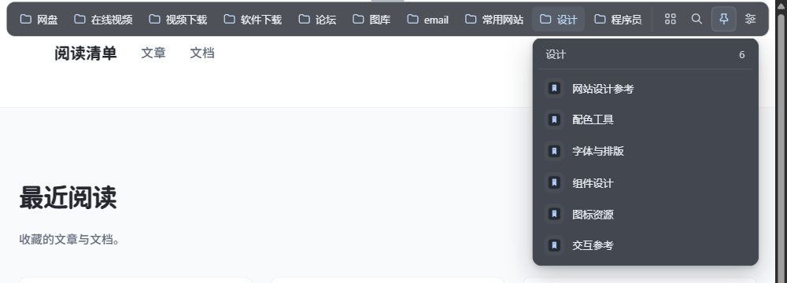
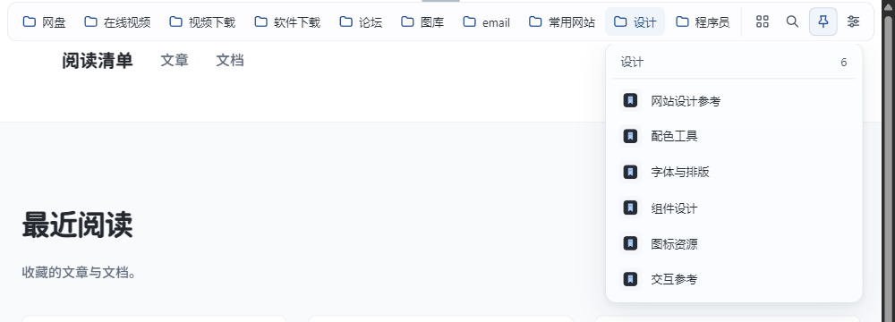
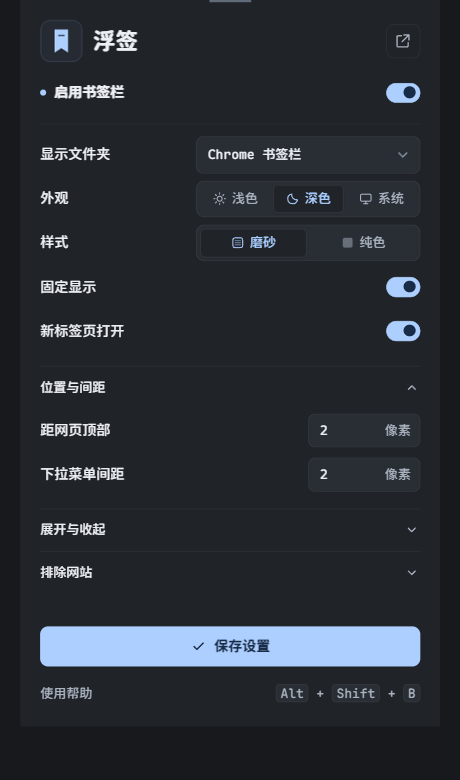

#  浮签 · 悬浮书签栏

鼠标移到网页顶部展开书签栏，移开后收起。直接使用 Chrome 已有的书签和文件夹。

**Chrome 111+ · Manifest V3 · 本地保存设置 · 无构建依赖**



<sub>当前源码的实际界面截图，使用示例书签与测试图标。悬浮栏覆盖在网页上方，不改变网页布局。</sub>

[快速安装](#快速安装) · [功能](#功能) · [设置](#设置) · [权限与数据](#权限与数据) · [开发验证](#开发验证)

> **开发预览**：当前 manifest 版本为 `1.1.1`，源码包含后续的动效、间距与收起修正，尚未发布新的安装包或上架应用商店。部分页面曾报告收起后横线残留；本机循环测试已通过，实际页面仍在验收，详见[验证记录](./VERIFICATION.md)。

## 功能

| 操作 | 行为 |
| --- | --- |
| 按需展开 | 靠近网页顶部出现，也可固定显示；移开后自动收起。 |
| 浏览文件夹 | 保留原生顺序，支持多级菜单、悬停切换与视口边缘避让。 |
| 全局搜索 | 按名称、网址和文件夹路径搜索；空格分隔多个关键词。 |
| 快捷打开 | 支持当前页、新标签页、中键及 Ctrl / Command 等组合操作。 |
| 调整外观 | 深色、浅色、跟随系统；磨砂或纯色；顶部与菜单间距独立配置。 |

原生书签新增、移动、重命名或删除后，浮签会更新。网址图标通过 Chrome 内置 favicon 接口读取；没有可用图标时保留通用图标。

<details>
<summary>查看浅色外观与设置页</summary>



<p align="center"></p>

</details>

## 快速安装

克隆源码，无需 `npm install` 或构建：

```bash
git clone https://github.com/auimus/floating-bookmarks.git
```

1. 在 Chrome 中打开 `chrome://extensions/`，开启右上角的「开发者模式」。
2. 点击「加载已解压的扩展程序」，选择克隆得到的 `floating-bookmarks` 文件夹，确保其中直接包含 `manifest.json`。
3. 刷新一个普通 HTTP / HTTPS 网页，把鼠标移到网页内容区域最顶部，停留约 0.1 秒。
4. 建议在 Chrome 扩展菜单中固定「浮签」，方便打开设置。

原生书签栏可用 `Ctrl+Shift+B` 隐藏。更新源码后，先在扩展管理页重新加载「浮签」，再刷新网页。请保留已加载的文件夹。

## 设置

右侧按钮依次为**全部书签、搜索、固定显示、设置**。

| 配置 | 默认值 | 可选范围 |
| --- | --- | --- |
| 外观 | 深色 | 深色 / 浅色 / 跟随系统 |
| 样式 | 磨砂 | 磨砂 / 纯色 |
| 距网页顶部 | 2px | 0–24px |
| 下拉菜单间距 | 2px | 0–16px |
| 展开 / 收起延迟 | 100 / 450ms | 0–700 / 150–2000ms |
| 顶部触发区 | 4px | 2–12px |

还可选择显示文件夹、新标签页打开、固定显示及排除的网站。保存后立即生效。域名按完整域名匹配，例如 `example.com` 与 `www.example.com` 需要分别填写。

<details>
<summary>键盘、鼠标与图标说明</summary>

- `Alt+Shift+B`：展开 / 收起。Chrome 快捷键冲突时可在 `chrome://extensions/shortcuts` 调整。
- `Tab`、上下方向键：选择书签；右方向键展开子菜单，左方向键返回；`Esc` 关闭菜单并收起。固定显示时，栏继续保留。
- `Ctrl` / `Command` 点击或中键点击：在后台新标签页打开；`Shift` 点击在前台新标签页打开。
- 书签超出栏宽时，可用鼠标滚轮横向浏览。搜索最多显示 100 条结果，可增加关键词缩小范围。
- 尚未访问的网站可能仍显示 Chrome 默认图标，可先打开一次该网站，再重新展开菜单。

</details>

## 权限与数据

| 权限 | 用途 |
| --- | --- |
| `bookmarks` | 读取原生书签树并监听变化。权限本身包含读写能力，但浮签代码不创建、修改、移动或删除书签。 |
| `storage` | 将设置保存到本机 `chrome.storage.local`，不上传、不跨设备同步。 |
| `favicon` | 通过 Chrome 内置接口读取网站图标，不使用第三方图标服务。 |

内容脚本只在 HTTP / HTTPS 页面的顶层文档运行。不使用远程脚本、分析服务或数据上传接口；点击书签时，浏览器按目标网址正常访问。卸载扩展会清除浮签设置，原有 Chrome 书签不受影响。

## 浏览器边界

- 悬浮栏位于网页内容区，不能添加到 Chrome 地址栏或标题栏。
- Chrome 内置页、新标签页、扩展商店、其他扩展页面和内置 PDF 阅读器不显示浮签；本地文件和 iframe 不注入。页面进入全屏时隐藏，退出后恢复。
- 顶部触发区会覆盖同一区域的网页点击；可缩小触发区或排除指定网站。
- `javascript:` 书签脚本与 `data:` 链接不执行。其他协议由浏览器处理，能否访问取决于 Chrome 的支持与策略。

## 开发验证

运行核心检查：

```bash
node tests/core.cjs
```

启动本机浏览器验收页：

```bash
node tests/browser/server.cjs
```

在终端给出的地址后使用以下路径；检查结果保存在被 Git 忽略的 `tests/browser/results/`：

| 路径 | 检查范围 |
| --- | --- |
| `/?state=verify&run=1` | 触发、收起、文件夹、搜索、图标与错误处理 |
| `/popup.html?state=verify&run=1` | 设置保存、读回和输入校验 |
| `/?state=layout-verify&run=1` | 间距、阴影、长菜单和视口边界 |
| `/?state=motion-verify&run=1` | 切换插值、连续打断和动画清理 |

测试使用可控的 Chrome API 替身与示例书签，不读取或修改真实书签；它不能替代真实扩展加载和网页兼容性验收。完整记录见 [VERIFICATION.md](./VERIFICATION.md)，界面约定见 [DESIGN.md](./DESIGN.md)。

<details>
<summary>源码结构</summary>

```text
manifest.json       扩展入口、权限与快捷键
background.js       书签 API、消息校验与设置写入
shared.js           设置归一化、书签树选择与搜索
content.js          悬浮栏、菜单、搜索与交互
bar-styles.js       Shadow DOM 界面样式
popup.*             设置页
icons/              本地扩展图标
assets/readme/      文档界面截图
tests/              核心与浏览器验收
```

</details>
